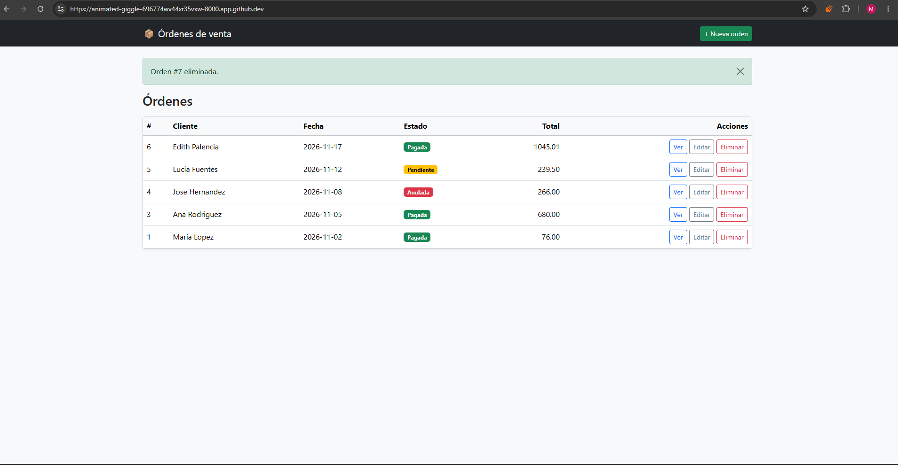
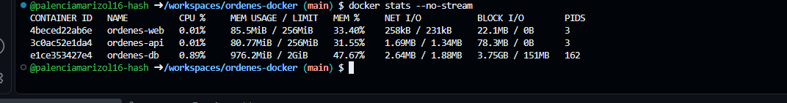

# 📦 Órdenes de venta – Arquitectura de 3 contenedores

Examen práctico del segundo parcial · Arquitectura de Computadoras

Aplicación de órdenes de venta con tres contenedores orquestados con Docker Compose: **SQL Server 2022** → **API Flask** → **Frontend Django**.

## alumna:Edith Marizol Palencia Diaz-202230120024

## 🏗️ Arquitectura

```
                  Red bridge: ordenes-net
 ┌──────────────────────────────────────────────────────────┐
 │                                                          │
 │  ┌──────────────┐  HTTP   ┌──────────────┐  TDS  ┌─────────────────┐
 │  │ web (Django) │ ──────► │ api (Flask)  │ ────► │ db (SQL Server) │
 │  │ puerto 8000  │ api:5000│ puerto 5000  │ db:1433│ 1433 (interno) │
 │  └──────────────┘         └──────────────┘       └────────┬────────┘
 │                                                           │
 └───────────────────────────────────────────────────────────┼────────┘
                                                             ▼
                                        Volumen con nombre: sqldata
                                        (montado en /var/opt/mssql)

 Navegador ──► http://localhost:8000     curl/Postman ──► http://localhost:5000
```

| Servicio | Tecnología | Puerto | Responsabilidad |
|----------|------------|--------|-----------------|
| `db` | SQL Server 2022 (imagen oficial) | interno | Guarda `OrdenesDB` (`ordenes`, `orden_detalle`) en el volumen `sqldata` |
| `db-init` | Misma imagen + sqlcmd | – | Ejecuta `db/init.sql` una vez y termina |
| `api` | Python + Flask + gunicorn | 5000 | CRUD REST en JSON; único servicio que usa la BD |
| `web` | Python + Django + gunicorn | 8000 | Pantallas CRUD; consume la API con `requests` |

Orden de arranque: `db` (healthy) → `db-init` (completo) → `api` (healthy) → `web`.

## ▶️ Ejecutar desde cero

Requisitos: Docker y Docker Compose v2.

```bash
git clone https://github.com/palenciamarizol16-hash/ordenes-docker.git
cd ordenes-docker
cp .env.example .env
# Editar .env: poner MSSQL_SA_PASSWORD y DOCKERHUB_USER
docker compose up -d --build
docker compose ps
```

- Frontend: http://localhost:8000
- API: http://localhost:5000/api/ordenes
- Health: http://localhost:5000/health

### ¿Cómo se ejecuta `init.sql`?

El servicio `db-init` del compose espera a que `db` esté sano y ejecuta `sqlcmd -i /init.sql`. El script es idempotente (crea la BD, las tablas y los datos de prueba solo si no existen). Manualmente: `docker compose run --rm db-init`.

### Detener

```bash
docker compose down      # conserva los datos (volumen)
docker compose down -v   # borra también el volumen
```

## 🔌 Endpoints de la API

| Método | Ruta | Acción | Códigos |
|--------|------|--------|---------|
| GET | `/api/ordenes` | Listar órdenes | 200 |
| GET | `/api/ordenes/<id>` | Ver orden con detalles | 200, 404 |
| POST | `/api/ordenes` | Crear orden | 201, 400 |
| PUT | `/api/ordenes/<id>` | Actualizar orden | 200, 400, 404 |
| DELETE | `/api/ordenes/<id>` | Eliminar orden y detalles | 200, 404 |
| GET/POST | `/api/ordenes/<id>/detalles` | Listar / agregar detalle | 200, 201, 400, 404 |
| PUT/DELETE | `/api/detalles/<id>` | Actualizar / eliminar detalle | 200, 400, 404 |
| GET | `/health` | Estado de la API | 200, 503 |

El total de la orden se recalcula al agregar, modificar o eliminar un detalle.

## 🐳 Imágenes en Docker Hub

- API: https://hub.docker.com/r/edithpalencia/ordenes-api (etiqueta `v1.0`)
- Web: https://hub.docker.com/r/edithpalencia/ordenes-web (etiqueta `v1.0`)

## ✅ Buenas prácticas aplicadas

- Un solo `compose.yaml`; todo arranca con `docker compose up -d --build`.
- `depends_on` con `condition: service_healthy` (api → db, web → api).
- Red bridge propia `ordenes-net` y volumen con nombre `sqldata`.
- Contraseña fuera del compose (archivo `.env`); se incluye `.env.example` sin secretos.
- Límites de CPU y memoria en cada servicio.
- Usuario sin privilegios (`USER appuser`) y `.dockerignore` en api y web.
- Dockerfiles ordenados para aprovechar la caché de capas.

## 📸 Evidencias

**1. `docker compose ps` con los tres servicios sanos**


**2. CRUD funcionando en el navegador**




**3. Pruebas de la API (curl): 200, 201 y 404**


**4. Persistencia tras `docker compose down` y `up`**


**5. `docker stats` con los límites de recursos**


